<h1 align="center">📄 Penetration Testing Report: Footprinting & Network Scanning</h1>

  <b>W2-PM-FINAL | CYBERSECURITY | BATCH B084H</b>

| Field | Details |
|:------|:--------|
| 👨‍💻 **Pentester Name** | Muhammad Ayaz |
| 🎓 **Program/Batch** | Network Walks | B084H |
| 📅 **Date** | 10-11-2026 |
| 📦 **Modules Completed** | W2-PM2 (GHDB Footprinting), W2-PM5 (Zenmap Scanning) |
| 🎯 **Client/Target** | 1. Public Internet (via Google Dorks)   2. My Local LAN Network |
| ✅ **Permission Secured?** | Yes (Publicly available OSINT & Own Local Network) |
| 📍 **Phases Covered** | Phase 1: Reconnaissance (Passive)   Phase 2: Scanning & Network Discovery |

---

## 1. Liability Disclaimer
I have performed these activities only on systems and devices where I had secured written permission, or on public information available via search engines, and my own local network. All materials are for educational and research purposes only. Do not use anything from here to break the law. Unauthorized access is a crime.

---

## 2. Introduction
This report covers two main modules as part of Week 2. 
1. **Passive Reconnaissance (W2-PM2):** Using the Google Hacking Database (GHDB) to find exposed IoT devices and downloadable resources on the public internet. 
2. **Active Scanning (W2-PM5):** Using Zenmap to scan my local network, discover live hosts, and map the network topology.

---

## 3. Tools Used
| Tool | Purpose |
|:---|:---|
| **Google Search (GHDB)** | Used advanced search operators (Dorks) for passive reconnaissance. |
| **Zenmap (Nmap GUI)** | Used for active network scanning and host discovery. |
| **Windows CMD** | Used to identify the local IP address and MAC address (via `ipconfig`). |

---

## 4. Activities Performed

### 4.1 Passive Reconnaissance (W2-PM2: GHDB)
I utilized Google Dorks to find sensitive information exposed on the internet without directly interacting with the target servers. 
*   **Task 1 (Vulnerable Cameras):** Found 10x live security camera interfaces accessible from the internet using dorks like `intitle:"webcamXP" inurl:8080` and `inurl:control/camerainfo`. The results included unauthenticated access to live feeds (e.g., WebcamXP 5, Foscam, Mobotix) and exposed directory listings (Index of /ipcam).
*   **Task 2 (Downloadable Ebooks):** Located 10x directory listings containing downloadable Mathematics PDFs using dorks like `intitle:"index of" "geometry" filetype:pdf`.

### 4.2 Network Scanning (W2-PM5: Zenmap)
For the active scanning phase, I used Zenmap to perform network discovery on my local network.
1.  I first used the Windows `ipconfig` command to identify my local IP address and subnet range.
2.  I entered the target subnet into Zenmap and ran a **Ping Scan** to identify active hosts.
3.  The scan identified multiple live hosts on the network and provided their corresponding IP and MAC addresses.
4.  Finally, I accessed the **Topology** tab in Zenmap to generate a visual map of the network and saved it as a PDF.

---

## 5. Risk Analysis / Impact

| # | Risk / Finding | Evidence / Observation | Potential Impact | Risk Level |
|:-:|:---|:---|:---|:---|
| 1 | **Exposed IoT Devices** | Live webcams (WebcamXP, Foscam) found via Google Dorks without authentication. | Unauthorized access to physical video feeds; privacy violation. | 🔴 Critical |
| 2 | **Directory Listing Enabled** | Google search revealed "Index of /ipcam" page exposing internal files. | Exposure of sensitive or unintended files to the public. | 🟠 Medium |
| 3 | **Active Hosts Discovered** | Zenmap ping scan identified live IPs and MACs. | Attackers can map the network and target specific active devices. | 🟠 Medium |

---

## 6. Recommendations
1.  **IoT Security:** Devices like security cameras should never be exposed directly to the internet. Use a secure VPN and change default credentials.
2.  **Server Configuration:** Disable directory listing to prevent unauthorized file browsing.
3.  **Network Monitoring:** Regularly scan your own local network to identify unauthorized devices.

---

## 7. Conclusion
During Week 2, I successfully completed the footprinting and network scanning modules. Using GHDB taught me how much sensitive data is publicly exposed, while Zenmap demonstrated how to map an internal network. These exercises highlighted that both passive and active reconnaissance are critical phases for any penetration test.

---

## 8. Evidence & Screenshots

### W2-PM2: GHDB Footprinting - Task 1 Results (Exposed Cameras)

**Google Dorks & Search Results (GHDB):**
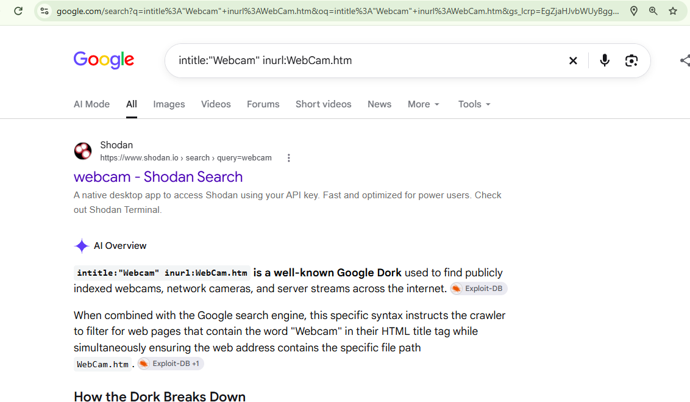
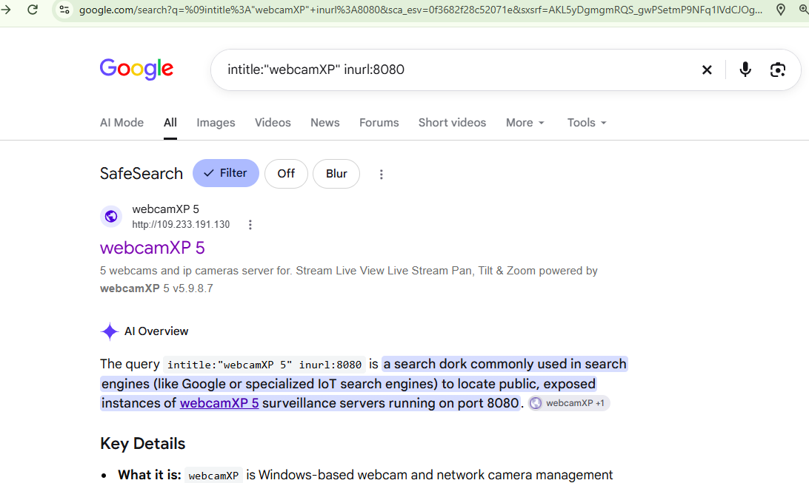
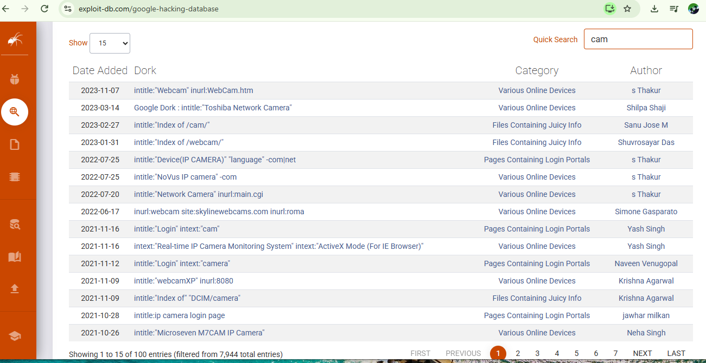

**Unauthenticated Live Camera Feeds & Interfaces:**
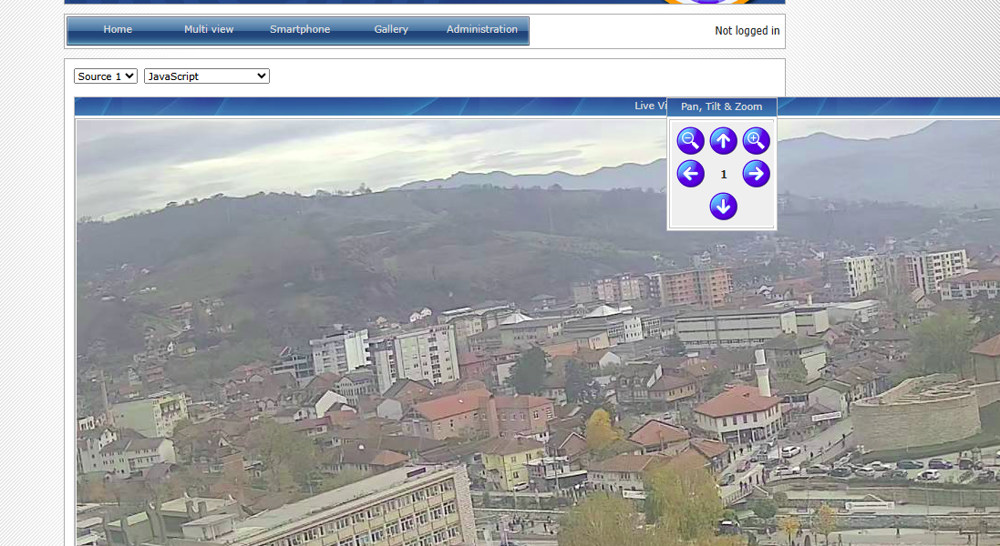
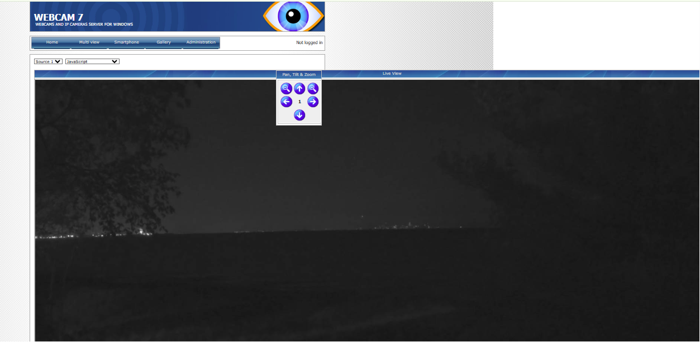
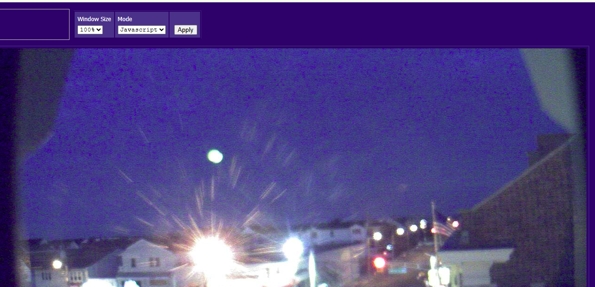

**Camera Status Pages & Multi-Views:**
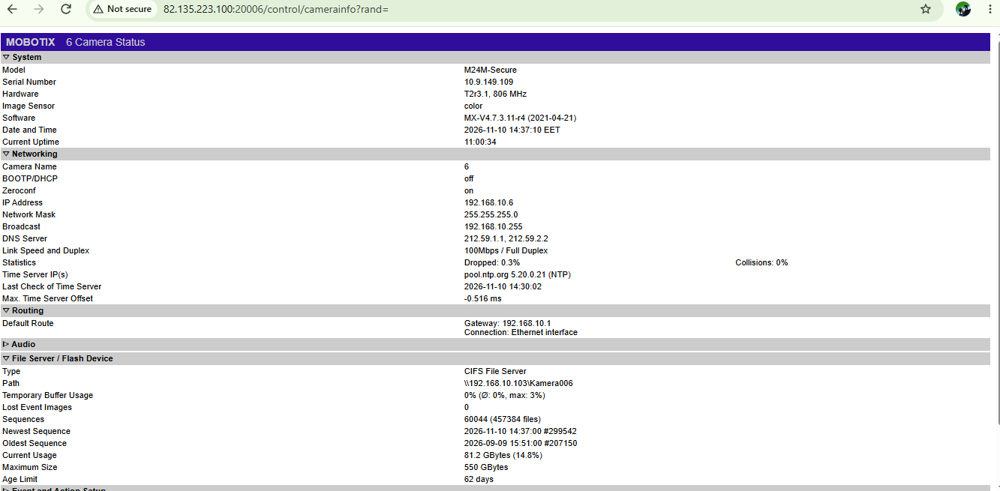
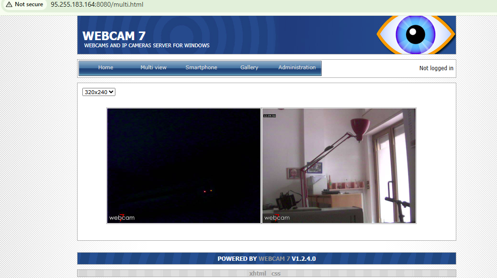
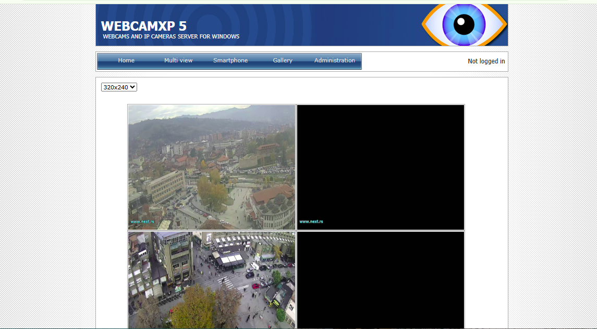
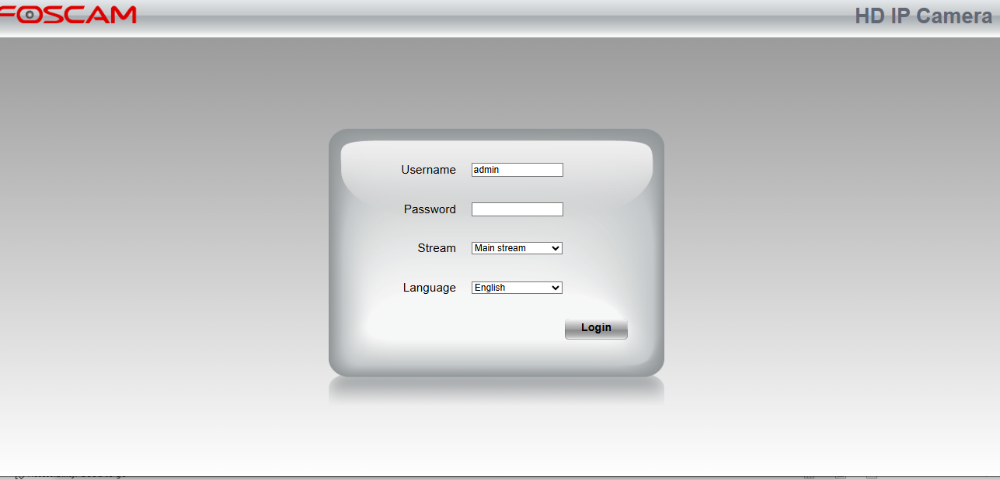

**Exposed Directory Listings:**
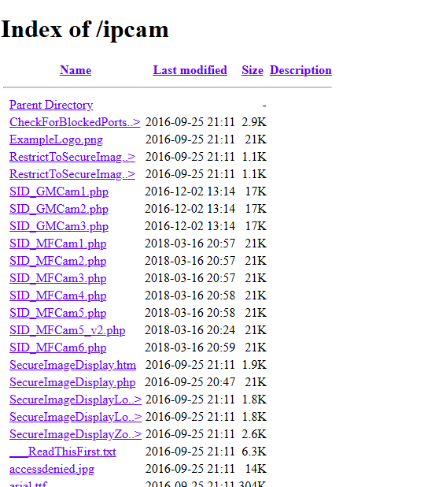

### W2-PM5: Zenmap Scanning & Topology
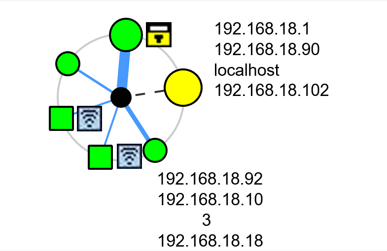

 

---

  <b>👤 Author</b> 
  Muhammad Ayaz 
  Cybersecurity Intern (Batch B084H) 
  <a href="https://github.com/ayazarshad64-ops">GitHub Profile</a>

