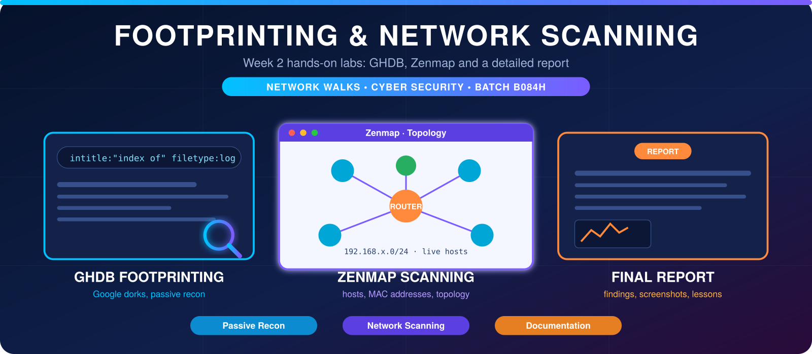

  

<h1 align="center">🕵️ Week 2: Footprinting & Network Scanning</h1>

  <b>Google Dorking (GHDB) & Live Target Reconnaissance</b>

| Field | Details |
|:------|:--------|
| 👨‍💻 **Student Name** | Muhammad Ayaz |
| 🐙 **GitHub** | [ayazarshad64-ops](https://github.com/ayazarshad64-ops) |
| 🎓 **Batch** | B084H |
| 🏢 **Internship** | Network Walks, Cyber Security Program |
| 🧑‍🏫 **Instructor** | Mr. Waqas Karim (CCIE) |
| 🛠️ **Tools Used** | Google Search (GHDB), Zenmap |

## 🎯 Objective
To utilize Google Hacking Database (GHDB) dorks for passive reconnaissance, identify exposed IoT devices (security cameras) on the internet, and locate downloadable educational resources. Document the findings in a structured format.

---

## 📝 Task 1: Exposed Security Camera Links
**Requirement:** Find 10x live vulnerable security camera links that are exposed & accessible from the internet. List them along with their relevant dork.

| No. | Link | Relevant Dork | Username / Password |
|:---:|:---|:---|:---|
| 1 | `http://109.233.191.130:8080/` | `intitle:"webcamXP" inurl:8080` | *(Empty/Default)* |
| 2 | `http://99.114.240.169:8080/` | `intitle:"Webcam" inurl:WebCam.htm` | None |
| 3 | `http://198.41.49.97:81/` | `intitle:"Device(IP CAMERA)" "language" -com\|net` | None |
| 4 | `http://109.233.191.130:8080/` | `inurl:mobile.html intitle:webcamXP` | None |
| 5 | `http://www.candas.name/ipcam/...` | `intitle: "Index of ipcam"` | None |
| 6 | `http://75.147.91.5:8000/` | `intitle:"NetCamSC*"` | None |
| 7 | `http://185.186.69.63:10082/` | `Camera Live Image" inurl:"guestimage.html"` | None |
| 8 | `http://95.255.183.164:8080/` | `intitle:webcam 7 inurl:8080 -intext:8080` | None |
| 9 | `http://82.135.223.100:20006/` | `inurl:control/camerainfo` | None |
| 10 | `http://46.44.238.67:88/` | `intitle:"IPCam Client"` | None |

---

## 📝 Task 2: Downloadable Mathematics Ebooks
**Requirement:** Find 10x listings which contain downloadable mathematics ebooks in PDF format using Google Dorks.

| No. | Link | Relevant Dork |
|:---:|:---|:---|
| 1 | `https://education.giakonda.org.uk/` | `intitle:index of" parent directory" mathematics pdf downloadale` |
| 2 | `(Search Result Link)` | `intitle:index of mathematics pdf downloadale` |
| 3 | `https://www.academia.edu/115056444/` | `advanced pure mathematics pdf` |
| 4 | `http://xtsunxet.usc.es/berndt2019` | `intitle:"index of" "geometry" filetype:pdf` |
| 5 | `https://www.istat.it/.../Index-of-statistical-table.pdf` | `intitle:"index of" "statistics" filetype:pdf` |
| 6 | `https://www.imo.universite-paris-saclay.fr/...` | `intitle:"index of" "algebra" filetype:pdf` |
| 7 | `https://www.math.cmu.edu/~wn0g/noll/FDS1%20ind.pdf` | `intitle:"index of" "calculus" filetype:pdf` |
| 8 | `https://math.libretexts.org/` | `inurl:"ebooks" "mathematics" filetype:pdf` |
| 9 | `https://cdn.oxfordowl.co.uk/2019/` | `intitle:"index of" "mathematics" filetype:pdf` |
| 10 | `https://www.jmap.org/htmltopics/Calculus` | `intitle:"index of" "math integration" filetype:pdf` |

---

## 🔍 Key Findings & Lessons Learned

> **Security Risks Identified:**
> - **Exposed IoT Devices:** Many security cameras are accessible over the public internet without any authentication. This poses a massive privacy and physical security risk. 
> - **Directory Listing Vulnerabilities:** Misconfigured web servers allow "Index of" directory listings, exposing internal files (like the math PDFs) to anyone using a simple Google search.
> - **Power of OSINT:** Google Dorking (GHDB) is a highly effective passive reconnaissance technique. It allows security researchers and attackers to find sensitive data without ever directly interacting with the target's network.

## 🛠️ Tools Used
- **Google Search Engine** (utilizing advanced search operators / dorks)
- **Google Hacking Database (GHDB)** for dork references
